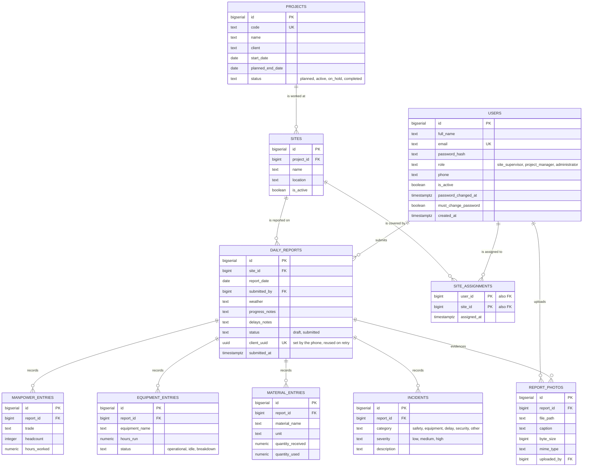

# SiteLog — Data Model

The entity relationship diagram for SiteLog, generated from the migrations in
`src/db/migrations/`. If the schema changes, this diagram changes with it.

**Tihama Limited (Constructions), Kano** — Information Technology Department.

---

## Entity relationship diagram

---

## Design decisions

**One report per site per day.** A unique constraint on `(site_id, report_date)` enforces it in the database rather than in application code. A second submission for the same day is refused with a clear conflict response instead of quietly creating a duplicate record for management to untangle later.

**`client_uuid` makes retries safe.** The phone generates this once when the supervisor presses Send, and reuses it on every retry. A unique index means a report resent three times from a failing connection is stored once. The API answers `200` rather than `201` when it already has the report, so the phone knows to stop retrying. Without this, the offline queue would duplicate every report it ever resent.

**Line items are separate tables, not columns.** A report has any number of trades, machines, materials and incidents. Storing them as repeated columns (`trade_1`, `trade_2`…) would cap what a supervisor can record and make "total masons this month" almost impossible to query. One row per entry keeps both open.

**`site_assignments` is a join table.** A supervisor can cover several sites and a site can have several supervisors. This table is also the access rule: a supervisor may only submit and read reports for sites they appear in here, checked on every request.

**Deletes cascade from the report down.** Removing a report removes its manpower, equipment, material, incident and photo rows with it. Line items have no meaning without their report, so leaving them behind would only create orphans.

**Roles are constrained in the database.** `role`, `status`, `category` and `severity` all carry `CHECK` constraints. A typo in application code cannot write a value the rest of the system does not understand.

---

## Indexes

Added in `003_dashboard_indexes.sql`, chosen for the queries the dashboard actually runs.

| Index | Supports |
|---|---|
| `daily_reports (report_date DESC)` | Recent reports, date-range filters |
| `daily_reports (site_id, report_date DESC)` | One site's history, the outstanding-reports check |
| `daily_reports (client_uuid)` unique, partial | Retry deduplication |
| `manpower_entries (trade)` | Manpower grouped by trade |
| `equipment_entries (equipment_name)` | Equipment utilisation |
| `sites (project_id)` partial on `is_active` | Scanning active sites of active projects |
| `incidents (category)` | Incident counts by type |

These queries are fine over fifty rows and slow over fifty thousand, which is where this will be after a year of daily reporting across several sites.

---

## Migration history

| File | Adds |
|---|---|
| `001_init.sql` | Core schema: users, projects, sites, reports and line items |
| `002_offline_and_photos.sql` | `client_uuid` for safe retries; photo metadata |
| `003_dashboard_indexes.sql` | Indexes supporting the dashboard aggregations |
| `004_password_management.sql` | `password_changed_at`, `must_change_password` |

Migrations are applied in filename order and recorded in `schema_migrations`, so running them twice is safe and the schema can be rebuilt from nothing.
